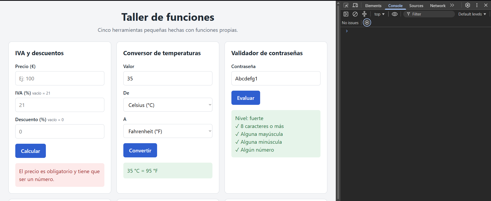
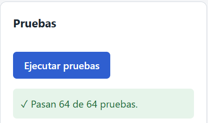

Readme · MD
# Taller de funciones
 
Página web con cinco herramientas pequeñas, hecha con JavaScript y funciones propias.
Práctica de Desarrollo Web en Entorno Cliente · 2º DAW · IES Juan García Valdemora.
 
**Página publicada:** https://unaipescador2-cmd.github.io/Funciones/
 
## Vista de la página
 

 
## Herramientas
 
1. **IVA y descuentos:** calcula el precio con descuento, el IVA y el total.
2. **Conversor de temperaturas:** pasa de Celsius a Fahrenheit y al revés.
3. **Validador de contraseñas:** dice si una contraseña es débil, media o fuerte.
4. **Generador de contraseñas:** crea una contraseña al azar de 6 a 30 caracteres.
5. **Contador de palabras:** cuenta palabras y caracteres, busca la palabra más larga y calcula el tiempo de lectura.
## Archivos del proyecto
 
| Archivo | Para qué sirve |
|---------|----------------|
| `index.html` | La página. |
| `estilos.css` | El diseño. |
| `funciones.js` | Solo los cálculos. No toca la página. |
| `app.js` | Conecta la página con los cálculos. |
| `pruebas.js` | Las pruebas de las funciones. |
| `notas.md` | Mis apuntes de cada fase. |
 
## Cómo usarlo
 
1. Descarga o clona el repositorio.
2. Abre `index.html` en el navegador.
3. Rellena los campos de una herramienta y pulsa su botón.
## Pruebas
 
En la parte de abajo de la página está el botón **Ejecutar pruebas**. Muestra cuántas pruebas pasan y cuáles fallan. El detalle también aparece en la consola del navegador (F12).
 

 
## Decisiones
 
- Los campos numéricos son de tipo texto para poder validarlos con `esNumeroValido`.
- Un precio vacío da un error y no se trata como 0. En el IVA, un campo vacío usa 21, y en el descuento usa 0.
- En el cálculo de precios se aplica primero el descuento y después el IVA.
## Autor
 
Unai Pescador Benito
 

