# Notas · Taller de funciones

## Fase 1 · Funciones predefinidas

| Línea | Mi predicción | Resultado | Tipo (typeof) |
|-------|---------------|-----------|---------------|
| 1. `parseInt("42")` | ESCRIBE AQUÍ TU PREDICCIÓN | 42 | number |
| 2. `parseInt("12px")` | ESCRIBE AQUÍ TU PREDICCIÓN | 12 | number |
| 3. `parseInt("px12")` | ESCRIBE AQUÍ TU PREDICCIÓN | NaN | number |
| 4. `Number("")` | ESCRIBE AQUÍ TU PREDICCIÓN | 0 | number |
| 5. `isNaN("")` | ESCRIBE AQUÍ TU PREDICCIÓN | false | boolean |
| 6. `Math.round(-2.5)` | ESCRIBE AQUÍ TU PREDICCIÓN | -2 | number |
| 7. `"oso".replace("o", "0")` | ESCRIBE AQUÍ TU PREDICCIÓN | "0so" | string |
| 8. `"a,b,c".split(",")` | ESCRIBE AQUÍ TU PREDICCIÓN | ["a", "b", "c"] | object (es un array) |
| 9. `0.1 + 0.2` | ESCRIBE AQUÍ TU PREDICCIÓN | 0.30000000000000004 | number |
| 10. `(1.005).toFixed(2)` | ESCRIBE AQUÍ TU PREDICCIÓN | "1.00" | string |

### Captura de la tabla

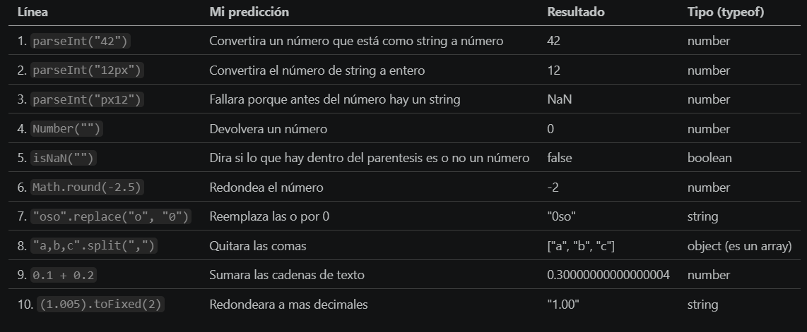

### Grupos de funciones

- **Convertir:** `parseInt`, `Number`, `toFixed`
- **Comprobar:** `isNaN`
- **Matemáticas:** `Math.round`
- **Texto:** `replace`, `split`
- **3 más que conozco:** `Math.random()`, `toUpperCase()`, `parseFloat()`

### Preguntas

1. **¿Qué da `Number("")`? ¿Por qué es un problema en un formulario?**
   Da `0`, no `NaN`. Si un campo se queda vacío, JavaScript lo trata como el número 0, y el programa cree que el usuario ha escrito un 0 cuando en realidad no ha escrito nada. Hay que comprobar que el campo no esté vacío antes de convertirlo.

2. **¿Qué diferencia hay entre `parseInt("12px")` y `parseInt("px12")`?**
   `parseInt` lee de izquierda a derecha y se para en el primer carácter que no es un número. En `"12px"` lee el 12 y se para en la `p`, así que devuelve 12. En `"px12"` el primer carácter ya no es un número, así que no lee nada y devuelve `NaN`.

3. **¿Por qué `0.1 + 0.2` no da 0.3? ¿Qué problema crearía en una tienda?**
   Los ordenadores guardan los decimales en binario, y números como 0.1 o 0.2 no se pueden representar de forma exacta, así que el resultado sale con un error minúsculo (0.30000000000000004). En una tienda, al sumar precios podrían salir céntimos de más o de menos, y comparaciones como `total === 0.3` darían `false`.

---

## Fase 2 · Funciones de precios y descuentos

### Funciones creadas

| Función | Qué hace | Ejemplo probado | Resultado |
|---------|----------|-----------------|-----------|
| `calcularIVA(precio, tipo = 21)` | Devuelve cuánto IVA hay que pagar | `calcularIVA(100)` | 21 |
| `calcularIVA(precio, tipo = 21)` | Con un tipo distinto | `calcularIVA(100, 10)` | 10 |
| `precioConIVA(precio, tipo = 21)` | Devuelve el precio más el IVA (usa `calcularIVA`) | `precioConIVA(50, 10)` | 55 |
| `aplicarDescuento(precio, porcentaje)` | Devuelve el precio tras el descuento | `aplicarDescuento(80, 25)` | 60 |
| `aplicarDescuento(precio, porcentaje)` | Con descuento 0 | `aplicarDescuento(80, 0)` | 80 |
| `redondear(numero, decimales = 2)` | Redondea a los decimales pedidos | `redondear(2.567)` | 2.57 |
| `redondear(numero, decimales = 2)` | Sin decimales | `redondear(2.5, 0)` | 3 |
| `redondear(numero, decimales = 2)` | Caso que falla con `toFixed` | `redondear(1.005)` | 1.01 |
| `formatearEuros(numero)` | Devuelve un texto con dos decimales, coma y € | `formatearEuros(1234.5)` | "1234,50 €" |

### Cómo he resuelto `redondear`

En la Fase 1 vi que `(1.005).toFixed(2)` da `"1.00"` porque 1.005 no se guarda exacto en binario. Por eso no uso `toFixed` para redondear. Multiplico por `10 ** decimales`, redondeo con `Math.round` y divido de nuevo. Antes de redondear sumo `Number.EPSILON`, el error mínimo de los decimales, para que 1.005 se redondee a 1.01.

### Dos pruebas más

1. **Función normal y función flecha.** He escrito `aplicarDescuento` de las dos formas:
   ```js
   function aplicarDescuento(precio, porcentaje) {
     return precio - (precio * porcentaje) / 100;
   }

   const aplicarDescuentoFlecha = (precio, porcentaje) =>
     precio - (precio * porcentaje) / 100;
   ```
   Con `aplicarDescuento(80, 25)` y `aplicarDescuentoFlecha(80, 25)` dan las dos 60. Hacen lo mismo; solo cambia la forma de escribirlas.

2. **Copia de `calcularIVA` con `console.log`.** He hecho `calcularIVAConsola`, que muestra el resultado con `console.log` en lugar de usar `return`, y la he usado dentro de `precioConIVAConsola`. Al ejecutar `precioConIVAConsola(50, 10)` la consola muestra un 5, pero la función devuelve `NaN`.

### Preguntas

1. **Con un ejemplo de tu código: ¿qué es un parámetro y qué es un argumento?**
   Los parámetros son los nombres que aparecen al definir la función. En `function calcularIVA(precio, tipo = 21)`, `precio` y `tipo` son parámetros. Los argumentos son los valores reales que se pasan al llamarla. En `calcularIVA(100, 10)`, el 100 y el 10 son los argumentos.

2. **¿Cuándo se usa un valor por defecto?**
   Cuando un dato puede no indicarse y existe un valor razonable de reserva. Por ejemplo, el IVA general es del 21 %, así que `tipo = 21` evita tener que escribirlo cada vez. Si llamo a `calcularIVA(100)`, `tipo` vale 21. Si llamo a `calcularIVA(100, 10)`, el valor por defecto se ignora y `tipo` vale 10.

3. **¿Qué pasó con la copia que usaba `console.log`? ¿Por qué?**
   La copia mostraba el resultado en la consola, pero no devolvía nada. `console.log` solo muestra un valor, no lo devuelve. Como la función no tiene `return`, devuelve `undefined`. Al hacer `precio + undefined` dentro de `precioConIVAConsola`, el resultado es `NaN`. Para que otra función pueda usar el resultado de una función, esta tiene que devolverlo con `return`.

### Capturas

Las cinco funciones probadas en la consola con los ejemplos del enunciado:

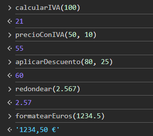

Los dos experimentos: la función flecha y la copia con `console.log` que devuelve `NaN`:

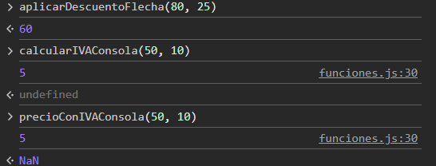

---

## Fase 3 · Funciones pequeñas

Regla de la fase: una función hace una sola cosa. Si para explicarla hace falta decir "hace esto Y además esto", se divide en dos.

### A · Temperaturas

| Función | Qué hace | Ejemplo probado | Resultado |
|---------|----------|-----------------|-----------|
| `celsiusAFahrenheit(c)` | Pasa de °C a °F con °C × 9 ÷ 5 + 32 | `celsiusAFahrenheit(100)` | 212 |
| `fahrenheitACelsius(f)` | Pasa de °F a °C con (°F − 32) × 5 ÷ 9 | `fahrenheitACelsius(32)` | 0 |
| `convertirTemperatura(valor, de, a)` | Elige cuál de las dos anteriores usar | `convertirTemperatura(100, "C", "F")` | 212 |
| `convertirTemperatura(valor, de, a)` | Si las unidades son iguales, devuelve el mismo valor | `convertirTemperatura(25, "C", "C")` | 25 |

`convertirTemperatura` no hace cálculos propios: decide y llama a `celsiusAFahrenheit` o a `fahrenheitACelsius`. Si recibe una unidad que no es "C" ni "F", devuelve `null`.

### B · Validador de contraseñas

| Función | Qué hace | Ejemplo probado | Resultado |
|---------|----------|-----------------|-----------|
| `longitudSuficiente(texto, minimo = 8)` | Comprueba la longitud mínima | `longitudSuficiente("1234567")` | false |
| `longitudSuficiente(texto, minimo = 8)` | | `longitudSuficiente("12345678")` | true |
| `tieneMayuscula(texto)` | Comprueba si hay alguna mayúscula | `tieneMayuscula("abc")` | false |
| `tieneMayuscula(texto)` | | `tieneMayuscula("aBc")` | true |
| `tieneMinuscula(texto)` | Comprueba si hay alguna minúscula | `tieneMinuscula("ABC")` | false |
| `tieneMinuscula(texto)` | | `tieneMinuscula("aBC")` | true |
| `tieneNumero(texto)` | Comprueba si hay algún número | `tieneNumero("abc")` | false |
| `tieneNumero(texto)` | | `tieneNumero("abc1")` | true |
| `evaluarContrasena(texto)` | Devuelve "débil", "media" o "fuerte" | `evaluarContrasena("Abcdefg1")` | "fuerte" |
| `evaluarContrasena(texto)` | | `evaluarContrasena("Abcdefgh")` | "media" |
| `evaluarContrasena(texto)` | | `evaluarContrasena("abc")` | "débil" |

Para detectar una mayúscula paso el texto a minúsculas con `toLowerCase()`: si el texto cambia, es que tenía alguna mayúscula. Con las minúsculas hago lo mismo con `toUpperCase()`. No he usado expresiones regulares. `evaluarContrasena` cuenta cuántos de los cuatro requisitos se cumplen: 4 es fuerte, 3 es media y menos de 3 es débil.

### C · Generador de contraseñas

| Función | Qué hace | Ejemplo probado | Resultado |
|---------|----------|-----------------|-----------|
| `numeroAleatorio(min, max)` | Entero al azar entre min y max, ambos incluidos | `numeroAleatorio(1, 6)` | 1, 2, 3, 4, 5 o 6 |
| `caracterAleatorio(conjunto)` | Un carácter al azar de un texto | `caracterAleatorio("abc")` | "a", "b" o "c" |
| `generarContrasena(longitud, opciones)` | Contraseña al azar de esa longitud | `generarContrasena(12)` | texto de 12 caracteres |
| `generarContrasena(longitud, opciones)` | Longitud no válida | `generarContrasena(3)` | null |

`numeroAleatorio` usa la fórmula `Math.floor(Math.random() * (max - min + 1)) + min`: `Math.random()` da un decimal entre 0 y 1, se multiplica por la cantidad de valores posibles, `Math.floor` quita los decimales y se suma `min`. Las opciones de `generarContrasena` se pasan en un objeto, por ejemplo `{ mayusculas: false }`, y por defecto mayúsculas y números están activados.

### D · Contador de palabras

| Función | Qué hace | Ejemplo probado | Resultado |
|---------|----------|-----------------|-----------|
| `palabras(texto)` | Lista de palabras, sin espacios repetidos ni saltos de línea | `palabras("hola mundo")` | ["hola", "mundo"] |
| `contarPalabras(texto)` | Cuántas palabras hay (usa `palabras`) | `contarPalabras("hola mundo")` | 2 |
| `contarPalabras(texto)` | | `contarPalabras("")` | 0 |
| `contarCaracteres(texto, conEspacios = true)` | Cuenta caracteres, con o sin espacios | `contarCaracteres("a b c")` | 5 |
| `contarCaracteres(texto, conEspacios = true)` | | `contarCaracteres("a b c", false)` | 3 |
| `palabraMasLarga(texto)` | Devuelve la palabra más larga | `palabraMasLarga("El perro rápido")` | "rápido" |
| `minutosLectura(texto, ppm = 200)` | Minutos de lectura, redondeados hacia arriba | `minutosLectura("hola")` | 1 |
| `minutosLectura(texto, ppm = 200)` | | `minutosLectura("")` | 0 |

### Preguntas

1. **¿Qué funciones usa `evaluarContrasena`? ¿Y `generarContrasena`?**
   `evaluarContrasena` usa `longitudSuficiente`, `tieneMayuscula`, `tieneMinuscula` y `tieneNumero`. `generarContrasena` usa `caracterAleatorio`, y esta a su vez usa `numeroAleatorio`.

2. **¿Cuál fue la función más difícil? ¿Por qué?**
   La más difícil fue `numeroAleatorio`, porque su fórmula tiene varios pasos seguidos. `Math.random()` da un decimal entre 0 y 1. Ese decimal se multiplica por la cantidad de números posibles (`max - min + 1`), `Math.floor` le quita los decimales y al final se suma `min`. Lo entendí probándola con `numeroAleatorio(1, 6)` muchas veces en la consola.

### Capturas

Cada grupo de funciones probado en la consola:

**Temperaturas**

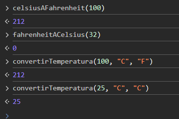

**Validador de contraseñas**

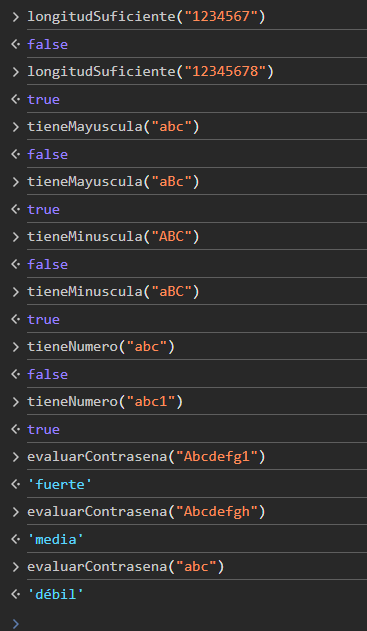

**Generador de contraseñas**

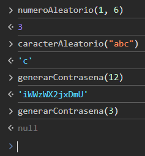

**Contador de palabras**

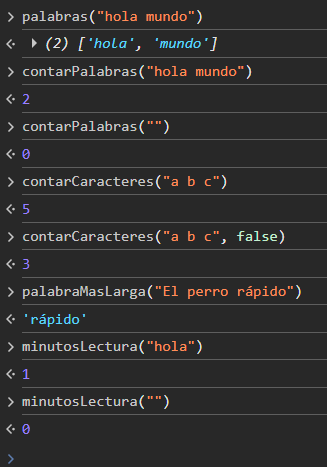

---

## Fase 4 · Interfaz de las cinco herramientas

En `index.html` hay una sección por herramienta, con sus campos, su botón y un sitio para el resultado. En `app.js` cada botón tiene su función (`manejarIVA`, `manejarTemperatura`, `manejarValidador`, `manejarGenerador` y `manejarPalabras`). Todas hacen lo mismo, en este orden: leen los campos, comprueban que están bien, calculan con mis funciones y muestran el resultado. Los errores se escriben en la página, sin usar `alert`.

Lo que escribe el usuario siempre llega como texto, así que uso `esNumeroValido` en todos los campos numéricos. En el IVA, si el campo está vacío se usa 21. En el descuento, si está vacío se usa 0. El precio vacío da un error.

### Preguntas

1. **¿Por qué el precio vacío no puede tratarse como 0?**
   Porque `Number("")` da 0. Si lo tratara como 0, el programa creería que el usuario ha escrito un precio de 0 € y daría un resultado que parece correcto, cuando en realidad falta el dato. Es mejor avisar con un error.

2. **Apunta tres funciones predefinidas que has usado en esta fase y para qué.**
   - `document.getElementById`: busca un elemento de la página por su id para leer o escribir en él.
   - `Number`: convierte un texto en número.
   - `trim`: quita los espacios del principio y del final, para detectar un campo que solo tiene espacios.

### Capturas

La página completa con las cinco herramientas:


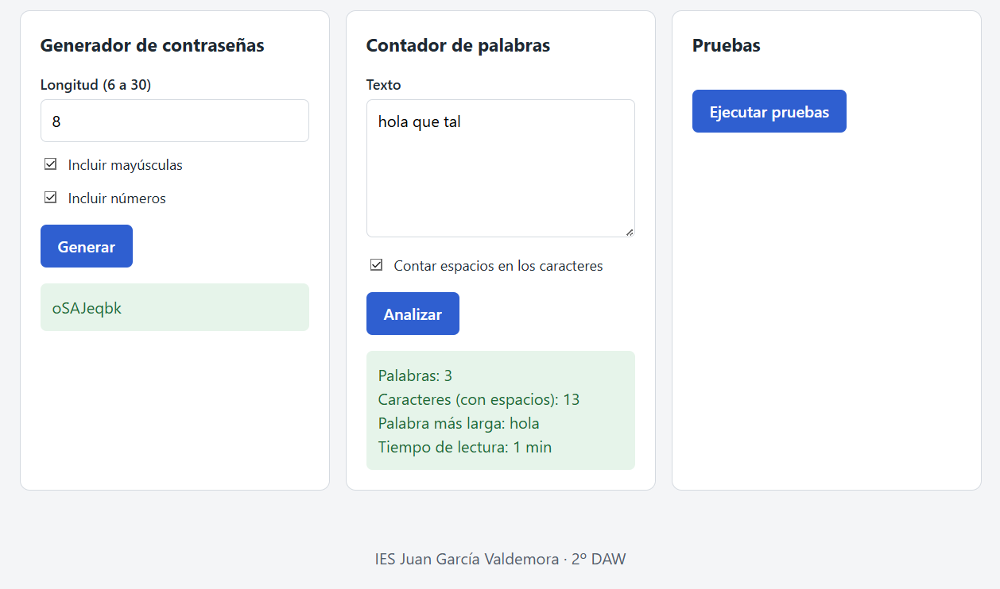

---

## Fase 5 · Pruebas de las funciones

En `pruebas.js` hay una función `probar(descripcion, obtenido, esperado)`. Compara lo que devuelve una función con lo que debería devolver, usa `console.assert` (que solo escribe un error en la consola cuando la comprobación es falsa) y guarda el resultado de cada prueba en una lista. Hay una función de pruebas por herramienta, con casos normales y casos límite (precio 0, texto vacío, -40 °C, longitud 6 y 30...). El botón "Ejecutar pruebas" muestra cuántas pasan y cuáles fallan.

Para el generador de contraseñas no se puede saber qué saldrá, pero sí se puede comprobar la longitud. Esa prueba se repite 20 veces con la función `todasVerdaderas`.

### Prueba de que las pruebas funcionan

Cambié a propósito el `+ 32` por `- 32` en `celsiusAFahrenheit`. Al ejecutar las pruebas fallaron estas cuatro:

- `celsiusAFahrenheit(100)`: dio 148 y se esperaba 212.
- `convertirTemperatura(100, C, F)`: dio 148 y se esperaba 212.
- `-40 °C son -40 °F (límite)`: dio -104 y se esperaba -40.
- `convertirTemperatura(0, C, F) cero`: dio -32 y se esperaba 32.

Después volví a poner `+ 32` y todas las pruebas pasaron otra vez.

### Preguntas

1. **¿Qué fallo introdujiste y qué prueba lo detectó?**
   Cambié el signo de `+ 32` a `- 32` en `celsiusAFahrenheit`. Lo detectaron cuatro pruebas de temperaturas, entre ellas `celsiusAFahrenheit(100)`, que daba 148 en vez de 212.

2. **¿Por qué no sirve una prueba que siempre pasa?**
   Porque no avisa cuando el código se rompe. Si la prueba sigue en verde aunque la función esté mal, da una falsa seguridad. Una prueba solo es útil si puede fallar.

### Capturas

Las pruebas detectan el fallo provocado a propósito (el signo de `celsiusAFahrenheit`):

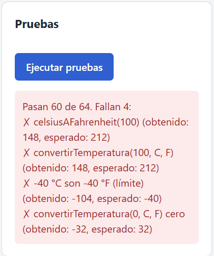

Después de arreglarlo, pasan todas las pruebas:


---

## Fase 6 · Documentación y revisión final

Encima de cada función de `funciones.js` he escrito un comentario con formato JSDoc (`/** ... */`). Cada uno dice qué hace la función, qué recibe con `@param` y qué devuelve con `@returns`.

### Revisión final

- Los nombres de las funciones se entienden (`calcularIVA`, `tieneMayuscula`, `contarPalabras`...).
- No hay código repetido. Las funciones se apoyan unas en otras: `precioConIVA` usa `calcularIVA`, `evaluarContrasena` usa las cuatro comprobaciones y `contarPalabras` usa `palabras`.
- He borrado el código de los experimentos de la Fase 2.
- La consola no muestra errores.

### Un error que me encontré y cómo lo arreglé

Al probar `redondear(2.567)` en la consola me salía `0` en vez de `2.57`. Para encontrar el fallo usé `console.log` dentro de la función y miré los valores de `factor` y del número multiplicado. Vi que el resultado intermedio era casi 0. El fallo era que había escrito `numero * Number.EPSILON` (una multiplicación) y debía ser `numero + Number.EPSILON` (una suma). `Number.EPSILON` es un número minúsculo, así que al multiplicar todo se quedaba en 0. Cambié el `*` por `+` y la función dio 2.57. Quité los `console.log` al terminar.

### Capturas

Una función de `funciones.js` con su comentario JSDoc (qué hace, qué recibe y qué devuelve):

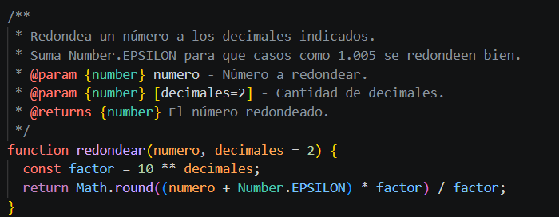

El `README.md` del proyecto:

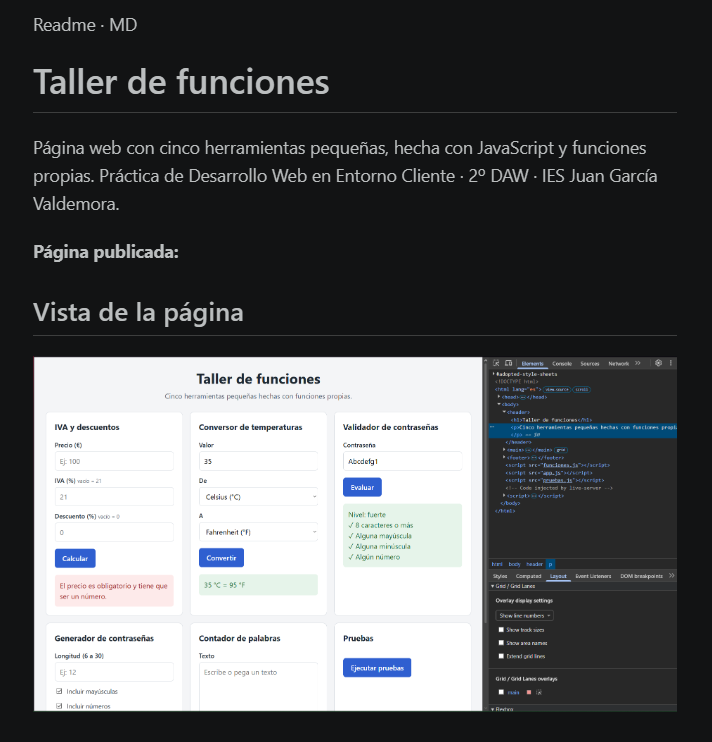